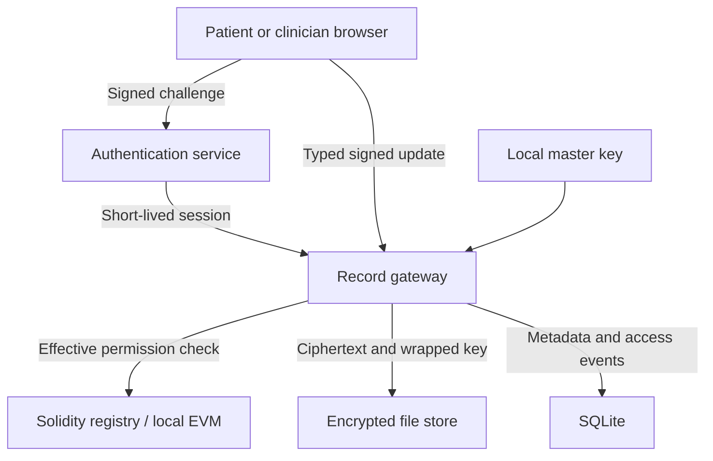

# Architecture and trust boundaries

## Local application

### Authentication

The browser signs a one-time challenge with its demonstration wallet. Challenges bind a nonce, origin, chain and registry and have a short lifetime. The gateway verifies the signer and consumes the challenge before issuing an expiring in-memory bearer token. Role selection cannot replace signature verification. The demonstration exposes its test keys to the same local user; it is intentionally not an adversarial multiuser deployment.

### Record creation and encryption

Each version is encrypted with a new random symmetric key and nonce. Authenticated additional data binds the record/version context. The version key is wrapped under the local master key. Encrypted envelopes are persisted off-chain; the contract stores a ciphertext hash and random locator commitment. Clinical content and titles are not placed on-chain.

### Consent and release

The gateway resolves the authenticated caller and evaluates current contract permissions before release. It checks the stored encrypted envelope against the selected contract commitment, unwraps and decrypts it, and records the release in an off-chain audit trail. A denied request is also auditable. Historical contract state and view calls do not constitute download logs.

### Signed updates

A staged update generates an EIP-712 signing request bound to the chain, registry, record, expected version and content commitment. The gateway verifies the signature and effective write authority again at commit. A compare-and-swap version argument prevents a stale update from silently replacing a more recent version. Submitted versions are immutable; corrections append a new version.

### Revocation

The patient's transaction removes a grant or advances their revocation epoch. The gateway checks permissions again for future requests. Previously downloaded plaintext and keys cannot be recalled. In-flight release and chain-ordering boundaries remain operational concerns; this prototype does not promise instantaneous remote erasure.

### Durability and atomicity

The chain, encrypted files and SQLite metadata are separate stores. Application serialization reduces conflicting local writes; it is not a distributed transaction across these stores. Unexpected process failure during a multi-store mutation can require reconciliation. Production deployment needs a durable outbox/state machine, idempotency, recovery jobs, chain-reorganization handling and monitoring.

### Audit anchoring

Audit events accumulate in SQLite with an implicit monotonic rowid. On request, the gateway hashes each event (keccak256 over its canonical field tuple), builds a Merkle root, and stores the root plus the covered rowid range in the companion AuditAnchor contract. Verification recomputes the root from the stored rows: any edit, insertion, or deletion inside the range changes the recomputed root or the row count and fails the check. Anchoring is per-patient and incremental — each anchor covers exactly the events since that patient's previous anchor, and the anchoring action itself becomes an event in the next range.

### FHIR export

`GET /api/records/:id/fhir` projects a record into a FHIR R4 Bundle at read time; nothing FHIR-shaped is stored. The Consent resource is derived from the live registry grant each request, so revocation and expiry are reflected immediately. Version payloads that already parse as FHIR resources are embedded; anything else is wrapped as a DocumentReference. The projection is read-only and gated by the same read permission as record content.

### Zero-knowledge consent proofs (separate prototype)

The `zk/` module prototypes replacing address-based grant checks with a proof: the presenter proves membership of a valid, unexpired grant in a Poseidon Merkle tree of grants, plus a scope-bound nullifier, without revealing the grant or the grantee. It is not wired into the gateway; the integration would snapshot live grants into the tree and publish the root beside the audit anchors. See `zk/README.md` for the exact statement proven and the development-setup caveat.

## Hosted browser demonstration

The same dashboard uses a local browser adapter. AES-GCM encryption and wallet signatures execute for real, while consent is simulated and no blockchain transactions occur. Synthetic records, demo identities and ciphertext remain within the browser's storage. This is a product walkthrough, not a hosted medical-record backend.

## Deliberate exclusions

No real clinician credential verification, external KMS, production wallet recovery, emergency override, guardian policy, real hospital integration, data-retention policy, clinical interpretation or compliance certification is included. FHIR-like synthetic content is for display and is not evidence of FHIR conformance validation.
